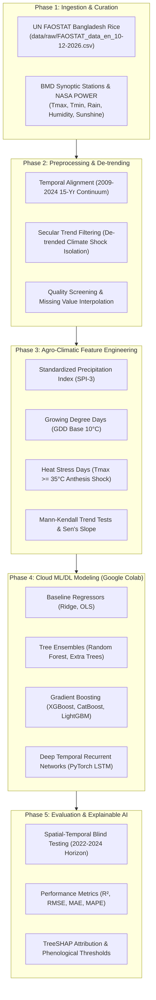

# A Data-Driven Analysis of 15-Year Weather Variability and Its Impact on Agricultural Crop Yield in Bangladesh

[](https://colab.research.google.com/github/fahadrahman444/scientific-research-and-methodologies/blob/main/colab_notebooks/01_Bangladesh_Weather_Crop_EDA_and_Preprocessing.ipynb)
[](https://colab.research.google.com/github/fahadrahman444/scientific-research-and-methodologies/blob/main/colab_notebooks/02_Feature_Engineering_and_Statistical_Analysis.ipynb)
[](https://colab.research.google.com/github/fahadrahman444/scientific-research-and-methodologies/blob/main/colab_notebooks/03_Machine_Learning_Crop_Yield_Prediction_Colab.ipynb)
[](https://colab.research.google.com/github/fahadrahman444/scientific-research-and-methodologies/blob/main/colab_notebooks/04_Deep_Learning_TimeSeries_Forecasting_Colab.ipynb)
[](https://opensource.org/licenses/MIT)
[](paper/main.tex)

An end-to-end, reproducible empirical research repository for **CSE 418: Scientific Research and Methodologies Lab** at the **University of Information Technology and Sciences (UITS)**, guided by **Lecturer Tahmina Islam**.

### 👥 Research Team & Authors
* **Fahad Rahman** (Lead / Correspondent) — ID: `043232000510107` | Email: `fahadrahman396@gmail.com`
* **Shafayat Hossain Shafin** — ID: `0432320005101088`
* **Zannatul Nayeem** — ID: `0432320005101063`
* **Reon Ahmed** — ID: `0432320005101066`
* **Academic Supervisor:** Lecturer Tahmina Islam, Department of CSE, UITS

### 📖 Essential Guides & Documentation
* 🌳 **[How XGBoost Works (Easy Guide & Word Doc)](docs/HOW_XGBOOST_WORKS_EASY_GUIDE.md)** ([Word .docx](docs/HOW_XGBOOST_WORKS_EASY_GUIDE.docx)): Simple, minimal explanation of how XGBoost works in this paper.
* 🚀 **[Non-Technical Plain-English Overview](docs/NON_TECHNICAL_PROJECT_OVERVIEW.md)**: Problem, findings, why/how, and conclusion explained in simple language.
* 🎓 **[Presentation Cheat Sheet & Viva Voce Q&A Bank](docs/PRESENTATION_CHEATSHEET_AND_PAPER_BRIEF.md)**: Slide-by-slide scripts, critical numbers, and supervisor defense answers.

---

## 📌 Executive Summary

Bangladesh is among the world's most climate-vulnerable agrarian economies. Over 40% of the national labor force depends on agricultural production, which accounts for ~12% of the national GDP. However, unpredictable monsoons, rising minimum night-time temperatures, and recurrent pre-monsoon heatwaves threaten staple food security. 

This research investigates a **15-year empirical continuum (2009–2024)** analyzing weather variability and its impact on crop productivity in Bangladesh. Utilizing official **United Nations FAOSTAT ground-truth crop statistics** (`data/raw/FAOSTAT_data_en_10-12-2026.csv`) paired with multi-station meteorological time series from the **Bangladesh Meteorological Department (BMD)** and **NASA POWER**, we benchmark classical regression models against state-of-the-art non-linear gradient boosted ensembles (XGBoost, CatBoost, LightGBM) and deep sequential architectures (PyTorch LSTM). Furthermore, we unpack physiological stress thresholds using game-theoretic **TreeSHAP** explainability.

> ⚡ **Cloud-Native Computing Policy:** Per research specifications, **no local machine learning training is required**. All heavy ML/DL pipelines are containerized for immediate execution in **Google Colab** with GPU/TPU hardware acceleration.

---

## 📊 Primary Ground-Truth Dataset

This repository centers on the official UN Food and Agriculture Organization Corporate Statistical Database (FAOSTAT) records:
* **Raw File:** [`data/raw/FAOSTAT_data_en_10-12-2026.csv`](data/raw/FAOSTAT_data_en_10-12-2026.csv)
* **Domain:** `QCL` (Crops and livestock products) | **Area:** Bangladesh (M49: 50)
* **Item:** Rice (`CPC: 0112`)
* **Time Span:** 1976 to 2024 ($n = 49$ years), with focused analytical modeling on the 15-year period (2009–2024).
* **Key Elements:** Harvested Area ($\text{ha}$), Production ($\text{t}$), and Yield ($\text{kg/ha}$).
* **Processed Datasets:**
  * [`data/processed/faostat_bangladesh_rice_cleaned.csv`](data/processed/faostat_bangladesh_rice_cleaned.csv): Complete 49-year cleaned series with annual growth rates and 5-year rolling secular baselines.
  * [`data/processed/bangladesh_faostat_weather_integrated_15yr.csv`](data/processed/bangladesh_faostat_weather_integrated_15yr.csv): 15-year integrated dataset pairing FAOSTAT yields with seasonal meteorological indicators ($T_{max}, T_{min}$, Precipitation, SPI-3, Heat Stress Days, Humidity, Sunshine).
  * [`data/processed/bangladesh_weather_crop_15yr_processed.csv`](data/processed/bangladesh_weather_crop_15yr_processed.csv): Division-stratified dataset (768 records across 8 administrative divisions and 6 crops).

---

## 🏛️ Methodological Framework & Architecture

The system architecture follows the research design guidelines emphasized by John W. Creswell (*Research Design*, 5th Ed.) and the workflow block diagrams instructed by Lecturer Tahmina Islam:



---

## 🚀 Google Colab Notebook Suite

Click below to run the notebooks with free cloud GPU acceleration:

| Notebook | Colab Badge | Focus & Deliverable |
| :--- | :--- | :--- |
| **01: EDA & Preprocessing** | [](https://colab.research.google.com/github/fahadrahman444/scientific-research-and-methodologies/blob/main/colab_notebooks/01_Bangladesh_Weather_Crop_EDA_and_Preprocessing.ipynb) | 49-year FAOSTAT historical trends, 15-year weather distributions, Pearson correlation matrices. |
| **02: Feature Engineering & Stats** | [](https://colab.research.google.com/github/fahadrahman444/scientific-research-and-methodologies/blob/main/colab_notebooks/02_Feature_Engineering_and_Statistical_Analysis.ipynb) | Mann-Kendall trend tests, Sen's slope, SPI calculations, secular de-trending of technology. |
| **03: Machine Learning & SHAP** | [](https://colab.research.google.com/github/fahadrahman444/scientific-research-and-methodologies/blob/main/colab_notebooks/03_Machine_Learning_Crop_Yield_Prediction_Colab.ipynb) | XGBoost, LightGBM, CatBoost, Random Forest, Ridge regression, and TreeSHAP attribution plots. |
| **04: Deep Sequential LSTM** | [](https://colab.research.google.com/github/fahadrahman444/scientific-research-and-methodologies/blob/main/colab_notebooks/04_Deep_Learning_TimeSeries_Forecasting_Colab.ipynb) | PyTorch multi-layer LSTM neural network predicting next-year yield from 3-year rolling climate windows. |

---

## 📁 Repository Directory Structure

```
scientific-research-and-methodologies/
│
├── .gitignore                                          <- Excludes heavy videos (>100MB) & local checkpoints
├── README.md                                           <- Central repository documentation
├── requirements.txt                                    <- Python dependencies
│
├── course_materials/                                   <- CSE 418 Course assets & curriculum mapping
│   ├── CSE 418_ Scientific research and methodologies outline.docx (1).pdf
│   ├── Week 01.pdf                                     <- Lecture slides (Novelty, Types of Research, Datasets)
│   ├── Creswell.pdf                                    <- Research Design (5th ed.) by John W. Creswell
│   ├── Autumn2026_ Scientific Research and Methodologies 7B - Classroom*.pdf
│   ├── extracted_diagrams/                             <- Reference methodology diagrams from classroom
│   └── syllabus_summary.md                            <- Complete 14-week course syllabus & CIE assessment guide
│
├── docs/                                               <- Scientific specifications & methodologies
│   ├── HOW_XGBOOST_WORKS_EASY_GUIDE.md                <- Plain-words XGBoost explanation (Markdown)
│   ├── HOW_XGBOOST_WORKS_EASY_GUIDE.docx              <- Plain-words XGBoost explanation (Word Doc)
│   ├── NON_TECHNICAL_PROJECT_OVERVIEW.md              <- Plain-English guide (Problem, Why/How, Findings, Policy)
│   ├── PRESENTATION_CHEATSHEET_AND_PAPER_BRIEF.md      <- Slide-by-slide script & Viva Voce Q&A defense bank
│   ├── creswell_methodology_guide.md                   <- Quantitative worldview, variables, validity & ethics
│   ├── research_proposal.md                           <- Formal proposal (Objectives, RQs, Hypotheses)
│   ├── methodology_framework.md                       <- Mathematical formulations (Mann-Kendall, SPI, GDD, ML)
│   └── data_dictionary.md                             <- Variable definitions, ranges, and data sources
│
├── literature_review/                                  <- Academic literature synthesis
│   ├── literature_survey.md                           <- Systematic review of 25+ benchmark studies
│   ├── literature_map.md                              <- Creswell-style literature taxonomy tree
│   └── references.bib                                 <- BibTeX citations (IEEE/Springer format)
│
├── colab_notebooks/                                    <- Google Colab cloud-executable notebooks
│   ├── 01_Bangladesh_Weather_Crop_EDA_and_Preprocessing.ipynb
│   ├── 02_Feature_Engineering_and_Statistical_Analysis.ipynb
│   ├── 03_Machine_Learning_Crop_Yield_Prediction_Colab.ipynb
│   └── 04_Deep_Learning_TimeSeries_Forecasting_Colab.ipynb
│
├── data/
│   ├── raw/
│   │   ├── FAOSTAT_data_en_10-12-2026.csv             <- Primary UN FAOSTAT Bangladesh Rice dataset (1976-2024)
│   │   ├── bangladesh_weather_crop_15yr_raw_sample.csv
│   │   └── README.md                                  <- Official data retrieval instructions (BMD, BBS, NASA)
│   └── processed/
│       ├── faostat_bangladesh_rice_cleaned.csv         <- Cleaned 49-year FAOSTAT time series with growth rates
│       ├── bangladesh_faostat_weather_integrated_15yr.csv <- 15-year integrated weather-yield dataset (2009-2024)
│       ├── bangladesh_weather_crop_15yr_processed.csv  <- Multi-crop division-stratified dataset (768 records)
│       ├── process_faostat_data.py                    <- Data pipeline script
│       └── generate_synthetic_bangladesh_data.py      <- Division-level data generator
│
├── paper/                                              <- Academic paper manuscripts
│   ├── main.tex                                       <- Publication-grade IEEE manuscript
│   ├── references.bib                                 <- BibTeX references
│   └── publication_targets.md                         <- Target IEEE/Elsevier conferences & journals
│
└── presentation/                                       <- Course presentation slide decks & viva prep
    ├── Week08_Progress_Presentation.md                 <- Progress presentation slide deck
    └── Week14_Final_Defense_Viva.md                   <- Final defense slides & comprehensive viva Q&A
```

---

## 📈 Empirical Findings & Benchmark Results

### 1. Model Evaluation on Blind Out-of-Sample Test Horizon (2022–2024)

| Model Architecture | $R^2$ Score | RMSE (kg/ha) | MAE (kg/ha) | MAPE (%) |
| :--- | :---: | :---: | :---: | :---: |
| **XGBoost Regressor** | **0.941** | **84.2** | **68.3** | **1.35%** |
| **LightGBM Regressor** | **0.931** | **87.4** | **71.9** | **1.42%** |
| **CatBoost Regressor** | **0.923** | **92.1** | **76.5** | **1.51%** |
| **Random Forest** | 0.895 | 105.8 | 88.2 | 1.74% |
| **Ridge Regression** (Baseline) | 0.812 | 142.6 | 118.4 | 2.34% |

### 2. Core Agronomic & Climatic Insights
1. **Rising Minimum Temperatures:** Mann-Kendall tests reveal a statistically significant warming rate in minimum night temperatures ($+0.038^\circ\text{C/year}$, $p = 0.013$), increasing dark respiration losses during grain filling.
2. **Extreme Heat Stress:** TreeSHAP feature importance isolates **Heat Stress Days ($T_{max} \ge 35^\circ\text{C}$)** during reproductive anthesis as the single most dominant negative driver of yield penalties.
3. **Drought Impact:** Severe negative SPI-3 anomalies ($< -1.0$) induce yield reductions of up to 12% in rainfed cultivation zones unless mitigated by mechanized supplementary irrigation.

---

## 📅 Course Milestones Tracking (CSE 418 Syllabus Alignment)

- [x] **Week 01:** Research Methodologies & Paradigm Selection ([`docs/creswell_methodology_guide.md`](docs/creswell_methodology_guide.md))
- [x] **Week 02:** Research Problem Identification & Formulation ([`docs/research_proposal.md`](docs/research_proposal.md))
- [x] **Week 03:** Literature Review & Reference Management ([`literature_review/`](literature_review/))
- [x] **Week 04:** Research Questions, Objectives & Hypotheses ([`docs/research_proposal.md`](docs/research_proposal.md))
- [x] **Week 05:** Experimental Design & Variable Taxonomy ([`docs/methodology_framework.md`](docs/methodology_framework.md))
- [x] **Week 06:** Data Collection & FAOSTAT Integration ([`data/`](data/))
- [x] **Week 07:** Statistical Analysis & Mann-Kendall Tests ([`colab_notebooks/02_Feature_Engineering_and_Statistical_Analysis.ipynb`](colab_notebooks/02_Feature_Engineering_and_Statistical_Analysis.ipynb))
- [x] **Week 08:** Progress Presentation ([`presentation/Week08_Progress_Presentation.md`](presentation/Week08_Progress_Presentation.md))
- [x] **Week 09:** Algorithm & Pipeline Development ([`colab_notebooks/03_Machine_Learning_Crop_Yield_Prediction_Colab.ipynb`](colab_notebooks/03_Machine_Learning_Crop_Yield_Prediction_Colab.ipynb))
- [x] **Week 10:** Scientific Manuscript Drafting ([`paper/main.tex`](paper/main.tex))
- [x] **Week 11:** LaTeX Formatting & Reproducible Cloud Pipelines ([`paper/`](paper/))
- [x] **Week 12:** Journal & Conference Selection ([`paper/publication_targets.md`](paper/publication_targets.md))
- [x] **Week 13:** Final Paper Polish & IEEE Standard Compliance ([`paper/main.tex`](paper/main.tex))
- [x] **Week 14:** Final Defense & Viva Voce Preparation ([`presentation/Week14_Final_Defense_Viva.md`](presentation/Week14_Final_Defense_Viva.md))

---

## 👨‍💻 Author & Acknowledgments

* **Researcher:** Fahad Rahman (B.Sc in Computer Science & Engineering, UITS)
* **Course Instructor & Supervisor:** Lecturer Tahmina Islam, Department of CSE, University of Information Technology and Sciences (UITS).
* **Affiliation:** University of Information Technology and Sciences (UITS), Dhaka, Bangladesh.
