# Research Methodology and System Architecture

This document specifies the end-to-end technical methodology, algorithmic formulations, and computational framework for the study: **"A Data-Driven Analysis of 15-Year Weather Variability and Its Impact on Agricultural Crop Yield in Bangladesh"**.

---

## 1. High-Level Architectural Workflow

The methodology adheres to standard scientific data mining and machine learning paradigms in precision agriculture, modeled after the reference workflows emphasized in the CSE 418 laboratory lectures:

```mermaid
flowchart TD
    subgraph Data_Acquisition ["1. Multi-Source Data Ingestion"]
        D1["BMD Weather Station Records<br>(15-Year Daily: Tmin, Tmax, Precip, RH, Sunshine)"]
        D2["NASA POWER / ERA5 Reanalysis<br>(Solar Radiation, Wind Speed, VPD)"]
        D3["BBS & DAE Agricultural Yearbooks<br>(District & Divisional Crop Yields: Aus, Aman, Boro, etc.)"]
    end

    subgraph Preprocessing ["2. Data Wrangling & Quality Assurance"]
        P1["Temporal Alignment & Aggregation<br>(Daily to Monthly & Phenological Stages)"]
        P2["Missing Value Imputation<br>(Spatiotemporal Spline & KNN)"]
        P3["Outlier Detection & Quality Screening<br>(Z-score / IQR Filtering)"]
        P4["Spatial Joins & Regional Normalization<br>(8 Administrative Divisions)"]
    end

    subgraph Feature_Engineering ["3. Feature Engineering & Statistical Analytics"]
        F1["Growing Degree Days (GDD) & Heat Stress Units"]
        F2["Standardized Precipitation Index (SPI-1, SPI-3)"]
        F3["Climate Anomalies (15-Year Baseline Deltas)"]
        F4["Mann-Kendall Trend Test & Sen's Slope"]
        F5["Multicollinearity Diagnostics (VIF) & Feature Selection"]
    end

    subgraph Cloud_Modeling ["4. Cloud ML/DL Modeling (Google Colab)"]
        M1["Baseline Regressors<br>(Ridge, Lasso, ElasticNet, OLS)"]
        M2["Ensemble Tree Models<br>(Random Forest, Extra Trees)"]
        M3["Gradient Boosting Regressors<br>(XGBoost, CatBoost, LightGBM)"]
        M4["Deep Sequential Architectures<br>(LSTM / Bi-LSTM / GRU)"]
    end

    subgraph Evaluation_XAI ["5. Evaluation, Validation & Explainability"]
        E1["Spatial-Temporal Cross Validation<br>(Time-Series Split & Leave-One-Division-Out)"]
        E2["Performance Metrics<br>(RMSE, MAE, R², MAPE)"]
        E3["Explainable AI (SHAP Analysis)<br>(TreeSHAP, Summary Plots, Feature Interactions)"]
    end

    subgraph Outcomes ["6. Research Outcomes & Academic Deliverables"]
        O1["IEEE Research Manuscript Draft"]
        O2["Empirical Evidence & Policy Recommendations"]
        O3["Open-Source Google Colab Pipeline"]
    end

    Data_Acquisition --> Preprocessing
    Preprocessing --> Feature_Engineering
    Feature_Engineering --> Cloud_Modeling
    Cloud_Modeling --> Evaluation_XAI
    Evaluation_XAI --> Outcomes
```

---

## 2. Mathematical & Statistical Formulations

### A. Non-Parametric Trend Detection: Mann-Kendall Test
To evaluate whether a 15-year meteorological series shows a monotonic upward or downward trend without assuming normality, the Mann-Kendall test statistic $S$ is computed:

$$S = \sum_{k=1}^{n-1} \sum_{j=k+1}^n \text{sgn}(x_j - x_k)$$

Where:
$$\text{sgn}(x_j - x_k) = \begin{cases} +1 & \text{if } (x_j - x_k) > 0 \\ 0 & \text{if } (x_j - x_k) = 0 \\ -1 & \text{if } (x_j - x_k) < 0 \end{cases}$$

For sample size $n \ge 10$, the variance of $S$ is given by:

$$\text{Var}(S) = \frac{n(n - 1)(2n + 5) - \sum_{i=1}^m t_i(t_i - 1)(2t_i + 5)}{18}$$

Where $m$ is the number of tied groups and $t_i$ is the number of data points in group $i$. The standard normal test statistic $Z_{MK}$ is calculated as:

$$Z_{MK} = \begin{cases} \frac{S - 1}{\sqrt{\text{Var}(S)}} & \text{if } S > 0 \\ 0 & \text{if } S = 0 \\ \frac{S + 1}{\sqrt{\text{Var}(S)}} & \text{if } S < 0 \end{cases}$$

At significance level $\alpha = 0.05$, the null hypothesis of no trend is rejected if $|Z_{MK}| > 1.96$.

### B. Sen's Slope Estimator
The magnitude of the 15-year trend rate is estimated using Sen's robust slope estimator:

$$\beta = \text{median}\left(\frac{x_j - x_k}{j - k}\right), \quad \forall 1 \le k < j \le n$$

### C. Growing Degree Days (GDD)
Crop physiological maturity depends on accumulated thermal units rather than calendar days:

$$\text{GDD} = \sum_{t=1}^N \max\left(\frac{T_{max,t} + T_{min,t}}{2} - T_{base}, 0\right)$$

Where $T_{base} = 10^\circ\text{C}$ for rice and maize, and $T_{base} = 5^\circ\text{C}$ for wheat and potato.

### D. Standardized Precipitation Index (SPI)
Meteorological drought severity is quantified via SPI by fitting monthly rainfall accumulations to a two-parameter Gamma distribution:

$$g(x) = \frac{1}{\beta^\alpha \Gamma(\alpha)} x^{\alpha - 1} e^{-x/\beta}, \quad \text{for } x > 0$$

The cumulative probability distribution $G(x)$ is transformed into a standard normal variable $Z$ with mean zero and variance one ($\text{SPI} \sim \mathcal{N}(0, 1)$). $\text{SPI} < -1.0$ indicates moderate to extreme drought; $\text{SPI} > +1.0$ indicates abnormally wet/flood conditions.

### E. Supervised Crop Yield Prediction Formulation
Given feature matrix $\mathbf{X} \in \mathbb{R}^{N \times d}$ representing meteorological aggregates, agro-climatic indices, regional encoding, and temporal trends, we seek to predict crop yield $y \in \mathbb{R}^N$ (MT/ha):

$$\hat{y}_i = f(\mathbf{x}_i; \mathbf{\Theta})$$

Where $f$ denotes the regression function parameterized by $\mathbf{\Theta}$.

### F. Model Optimization Objectives
For **XGBoost Regressor**, the objective function minimized at iteration $t$ with second-order Taylor expansion is:

$$\mathcal{L}^{(t)} \approx \sum_{i=1}^n \left[ g_i f_t(\mathbf{x}_i) + \frac{1}{2} h_i f_t^2(\mathbf{x}_i) \right] + \Omega(f_t)$$

Where $g_i = \partial_{\hat{y}^{(t-1)}} l(y_i, \hat{y}^{(t-1)})$ and $h_i = \partial^2_{\hat{y}^{(t-1)}} l(y_i, \hat{y}^{(t-1)})$, and $\Omega(f_t) = \gamma T + \frac{1}{2} \lambda \sum_{j=1}^T w_j^2$ acts as the regularization penalty.

### G. Long Short-Term Memory (LSTM) Architecture
To capture recurrent multi-year dependencies, sequential weather memory cells are governed by:

$$\begin{aligned}
f_t &= \sigma(W_f [h_{t-1}, x_t] + b_f) \quad \text{(Forget Gate)} \\
i_t &= \sigma(W_i [h_{t-1}, x_t] + b_i) \quad \text{(Input Gate)} \\
\tilde{C}_t &= \tanh(W_c [h_{t-1}, x_t] + b_c) \quad \text{(Candidate Memory)} \\
C_t &= f_t * C_{t-1} + i_t * \tilde{C}_t \quad \text{(Cell State Update)} \\
o_t &= \sigma(W_o [h_{t-1}, x_t] + b_o) \quad \text{(Output Gate)} \\
h_t &= o_t * \tanh(C_t) \quad \text{(Hidden State)}
\end{aligned}$$

---

## 3. Evaluation Metrics

Models are evaluated across four standard regression metrics:

1. **Root Mean Square Error (RMSE):**
   $$\text{RMSE} = \sqrt{\frac{1}{N} \sum_{i=1}^N (y_i - \hat{y}_i)^2}$$

2. **Mean Absolute Error (MAE):**
   $$\text{MAE} = \frac{1}{N} \sum_{i=1}^N |y_i - \hat{y}_i|$$

3. **Coefficient of Determination ($R^2$):**
   $$R^2 = 1 - \frac{\sum_{i=1}^N (y_i - \hat{y}_i)^2}{\sum_{i=1}^N (y_i - \bar{y})^2}$$

4. **Mean Absolute Percentage Error (MAPE):**
   $$\text{MAPE} = \frac{100\%}{N} \sum_{i=1}^N \left| \frac{y_i - \hat{y}_i}{y_i} \right|$$

---

## 4. Explainable AI: SHAP (SHapley Additive exPlanations)

To unpack model predictions, game-theoretic Shapley values allocate the marginal contribution of each weather variable:

$$\phi_i(x) = \sum_{S \subseteq F \setminus \{i\}} \frac{|S|!(|F| - |S| - 1)!}{|F|!} \left[ f(S \cup \{i\}) - f(S) \right]$$

This produces feature importance rankings and interaction dependency plots that reveal specific temperature and rainfall thresholds causing yield penalties in Bangladesh.
