# Creswell Literature Map: Weather Variability & Crop Yield Analytics

Following John W. Creswell's framework (Chapter 2, *Review of the Literature*), this literature map structures the domain into hierarchical conceptual clusters, contextualizing where the proposed research contributes novel insights:

```mermaid
graph TD
    Root["A Data-Driven Analysis of 15-Year Weather Variability<br>and Its Impact on Agricultural Crop Yield in Bangladesh"]

    Branch1["Cluster 1: Climate Science & Bangladesh Meteorology"]
    Branch2["Cluster 2: Econometric & Classical Crop Models"]
    Branch3["Cluster 3: Machine Learning & Time-Series AI"]
    Branch4["Cluster 4: Explainable AI & Agrometeorology"]

    Root --> Branch1
    Root --> Branch2
    Root --> Branch3
    Root --> Branch4

    Branch1 --> B1_1["Long-term precipitation trends<br>(Shahid 2010)"]
    Branch1 --> B1_2["Meteorological Drought Assessment via SPI<br>(Alamgir et al. 2015)"]
    Branch1 --> B1_3["BMD Historical Synoptic Data<br>(BMD 2024 Reports)"]

    Branch2 --> B2_1["Cobb-Douglas & Production Frontiers<br>(Sarker et al. 2012, 2014)"]
    Branch2 --> B2_2["ARDL Cointegration Models<br>(Chowdhury et al. 2021)"]
    Branch2 --> B2_3["Linear Crop Regression Pitfalls<br>(Rahman et al. 2018)"]

    Branch3 --> B3_1["Tree-based Ensembles: RF & XGBoost<br>(Chen & Guestrin 2016, Nasir 2020)"]
    Branch3 --> B3_2["Categorical Gradient Boosting: CatBoost<br>(Prokhorenkova et al. 2018)"]
    Branch3 --> B3_3["Deep Recurrent Networks: LSTM / GRU<br>(Khaki & Wang 2019, Hochreiter 1997)"]

    Branch4 --> B4_1["Game-Theoretic Feature Attribution: SHAP<br>(Lundberg & Lee 2017)"]
    Branch4 --> B4_2["Phenological Threshold Extraction<br>(Agronomic Extension Policy)"]

    %% Novelty synthesis
    Novelty["=== NOVEL CONTRIBUTION OF THIS STUDY ===<br>• 15-Year Longitudinal Continuum (2009-2024)<br>• Division-Stratified 8-Region Analysis<br>• 6 Foundation Crops (Rice, Wheat, Potato, Jute)<br>• Cloud-Native Colab Pipeline + SHAP Interpretability"]
    
    Branch1 -.-> Novelty
    Branch2 -.-> Novelty
    Branch3 -.-> Novelty
    Branch4 -.-> Novelty

    style Root fill:#1f77b4,stroke:#333,stroke-width:2px,color:#fff
    style Novelty fill:#2ca02c,stroke:#333,stroke-width:2px,color:#fff
```

